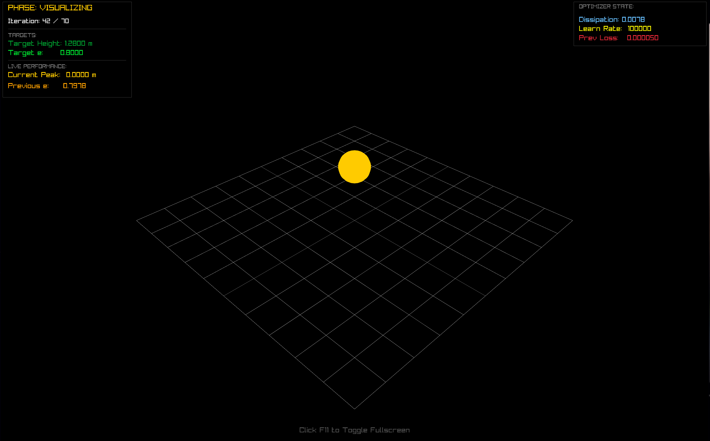

# Differential Physics Engine

**DiffX** is an experimental differentiable physics simulator written in C++17. It combines forward-mode automatic differentiation with time-stepped physical simulation, allowing gradients to propagate through the simulation and be used to optimize physical parameters.

The current implementation focuses on simulating a bouncing body and experimenting with gradient-based parameter tuning. It uses custom mathematical types, a simulation-state history, and a real-time 3D visualization built with Raylib.



## Features

- **Forward-Mode Automatic Differentiation:** Custom dual numbers propagate derivatives through arithmetic operations and supported mathematical functions.
- **Differentiable Simulation:** Physical state updates operate on values that carry both numerical values and derivatives.
- **Custom Vector Mathematics:** A templated 3D vector implementation supporting vector addition, scalar multiplication, dot products, and cross products.
- **Matrix Operations:** A custom $3 \times 3$ matrix implementation with multiplication, transposition, and inversion.
- **Quaternion Mathematics:** Quaternion representation, multiplication, conjugation, and norm calculations.
- **Rigid-Body Representation:** Structures for body mass, inverse mass, inertia tensors, restitution, position, orientation, velocity, and applied forces.
- **Simulation State History:** A simulation tape stores successive system states, making simulation trajectories available for inspection.
- **Gradient-Based Parameter Tuning:** Derivatives of a simulation loss are used to update a physical parameter through gradient descent.
- **Real-Time 3D Visualization:** Raylib renders the bouncing body, simulation environment, and live parameter information.
- **Fullscreen Support:** Toggle fullscreen mode during visualization.

## Core Idea: Differentiable Physics

Traditional physics simulations calculate how a system evolves given its physical parameters. A differentiable simulator additionally tracks how the computed quantities change when those parameters change.

DiffX implements forward-mode automatic differentiation using dual numbers:

$$
x = v + \varepsilon d, \qquad \varepsilon^2 = 0
$$

Here, $v$ is the numerical value and $d$ is its derivative with respect to a selected parameter.

For example, multiplication propagates derivatives according to the product rule:

$$
(a b)' = a'b + ab'
$$

The custom `Dual` type implements derivative propagation for arithmetic operations, as well as exponential, sine, and cosine functions.

By seeding a parameter with a derivative of $1$, the simulator can propagate sensitivity information through its calculations alongside the ordinary numerical values.

## Simulation Architecture

### 1. Core Mathematics

The `core` module contains the mathematical primitives used throughout the engine.

| Component | Purpose |
|---|---|
| `dual.hpp` | Dual numbers and forward-mode derivative propagation |
| `vector3.hpp` | Templated 3D vector operations |
| `matrix3x3.hpp` | Matrix multiplication, transpose, and inverse |
| `quaternion.hpp` | Quaternion representation and basic operations |

These components provide a foundation for physical calculations with both ordinary numerical values and differentiable quantities.

### 2. Rigid-Body Representation

The `engine` module defines the main simulation data structures.

- `BodyDefinition` stores physical properties such as mass, inverse mass, inertia tensor, and restitution.
- `Rigidbody` stores a body's position, orientation, linear and angular velocities, and applied force.
- `SystemState` represents the state of the simulated bodies at a particular point in time.

The engine uses templates so that simulation structures can work with different numerical types.

### 3. Time Integration

The `Solver` advances a system by applying forces to update linear velocity and position.

For a body with mass $m$, force $F$, velocity $v$, and timestep $\Delta t$, the implemented translational update follows:

$$
v_{t+\Delta t} = v_t + \frac{F_t}{m}\Delta t
$$

$$
x_{t+\Delta t} = x_t + v_t\Delta t
$$

The solver uses the velocity from the current state when updating position. It then clears the applied force in the next state.

### 4. Simulation Tape

The `Simulation` class manages the forward simulation and stores the resulting sequence of system states.

Each forward step produces a new state and appends it to the simulation tape. This provides a history of the simulated trajectory and allows later states to be inspected.

### 5. Gradient-Based Optimization

The main demonstration uses a bouncing body to experiment with parameter optimization.

The simulation includes gravity and a height-dependent spring-damping force. Its parameters determine how the body responds near the ground.

A squared-error objective compares a simulated height quantity against a target height:

$$
L = (h_{\text{sim}} - h_{\text{target}})^2
$$

The main loop obtains a derivative through automatic differentiation and updates the dissipation parameter using a gradient-descent step:

$$
\theta_{\text{new}} = \theta_{\text{old}} - \eta \frac{\partial L}{\partial \theta}
$$

Here, $\theta$ is the parameter being optimized and $\eta$ is the learning rate.

This demonstrates how a differentiable simulation can be used to investigate the relationship between physical parameters and simulated behavior.

## Real-Time Visualization

The application uses Raylib to display the simulation in a 3D environment.

The current interface includes:

- A 3D view of the bouncing body and reference grid
- The current optimization iteration
- The configured target height and target restitution parameter
- The tracked peak height during the simulation
- The current dissipation parameter and learning rate
- Information about the previous optimization step

The visualization makes it possible to observe the simulated motion and monitor the parameter-tuning process as it runs.

## Tech Stack

| Technology | Role |
|---|---|
| C++17 | Simulation and numerical implementation |
| Raylib | Real-time graphics and window management |
| Custom dual numbers | Forward-mode automatic differentiation |
| Custom vector and matrix types | Mathematical operations |
| Quaternions | Orientation representation and quaternion operations |
| Make | Build automation |

## Project Structure

```text
DifferentialPhysicsEngine/
├── include/
│   ├── core/
│   │   ├── dual.hpp
│   │   ├── matrix3x3.hpp
│   │   ├── quaternion.hpp
│   │   └── vector3.hpp
│   ├── engine/
│   │   ├── body_definition.hpp
│   │   ├── optimizer.hpp
│   │   ├── rigidbody.hpp
│   │   ├── simulation.hpp
│   │   ├── solver.hpp
│   │   └── system_state.hpp
│   └── raylib.h
├── src/
│   └── main.cpp
├── examples/
│   └── e_predict.cpp
├── images/
│   └── image.png
├── build/
├── Makefile
├── run.sh
├── libraylib.a
```

## Requirements

- A C++17-compatible compiler, such as GCC
- GNU Make
- Linux with an X11-compatible graphics environment
- OpenGL and the system libraries required by Raylib

The repository includes the Raylib header and a static library. The linker configuration also references system libraries including OpenGL, pthread, and X11.

## Build and Run

Clone the repository:

```bash
git clone https://github.com/VivaanMalik/DifferentialPhysicsEngine.git
cd DifferentialPhysicsEngine
```

Run the provided launch script:

```bash
chmod +x run.sh
./run.sh
```

Alternatively, build and launch the application with Make:

```bash
make -j4
./build/diff_engine
```

To compile from scratch after cleaning previous build artifacts:

```bash
make clean
make -j4
```

The default build compiles the source files in `src/` and produces the `build/diff_engine` executable.

## Controls

| Key | Action |
|---|---|
| `F11` | Toggle fullscreen mode |
| `Esc` or window close | Exit the application |

## Current Scope and Limitations

DiffX is an experimental differentiable physics project rather than a complete general-purpose physics engine.

The current implementation focuses on translational integration and gradient-based experimentation with a bouncing body.

- **Rotational dynamics:** Quaternion, angular-velocity, and inertia data structures exist, but the current solver does not implement full rotational dynamics.
- **Collision handling:** The current solver does not provide a general collision-detection and contact-resolution pipeline.
- **Optimization:** The optimizer interface is currently a scaffold; the parameter update in the main demonstration is implemented directly in the simulation loop.
- **Gradient stability:** Optimization behavior depends on the simulated dynamics, timestep, parameter initialization, and learning rate.
- **Objective consistency:** The main demonstration computes its loss using the final simulated vertical position, while separately tracking the post-impact peak height. These quantities are not necessarily equivalent, so the loss should be aligned with the intended optimization target when tuning rebound height.
- **Testing:** The project does not currently include a comprehensive automated test suite.

These limitations define the current scope and provide directions for future development.

## Future Directions

Potential extensions include:

- Completing rotational dynamics and orientation integration
- Adding collision detection and contact resolution
- Developing a reusable optimization interface
- Supporting optimization of multiple physical parameters
- Adding trajectory visualization and numerical diagnostics
- Building automated tests for the mathematical primitives, solver, and gradient calculations

## License

No repository-level license is currently specified. Check the licenses of the included Raylib files and other dependencies before redistributing the project.

## Author

**Vivaan Malik**